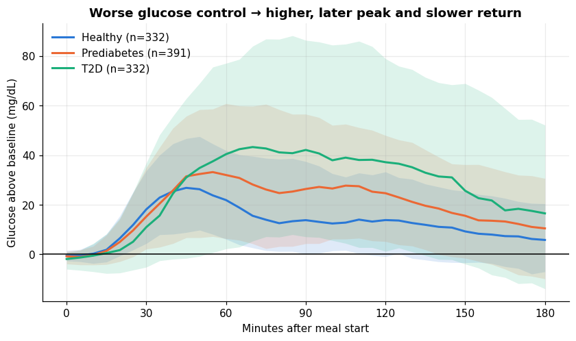
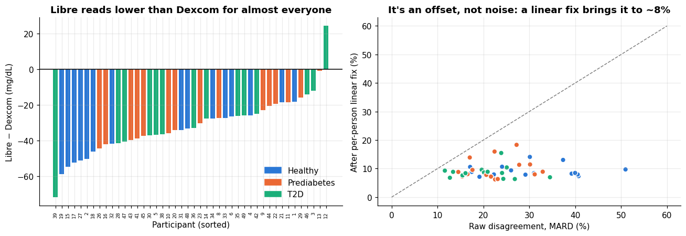
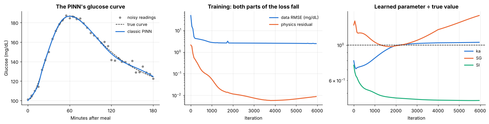
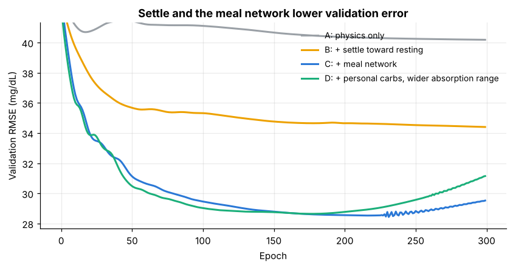
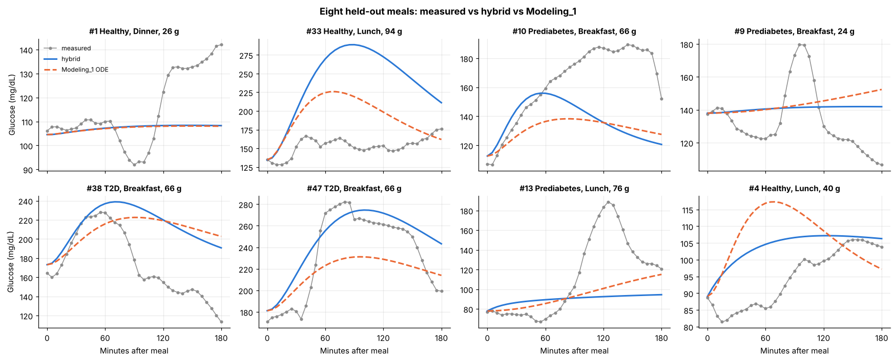
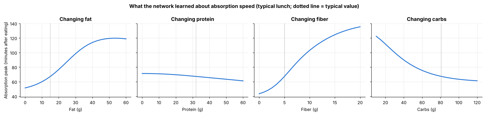
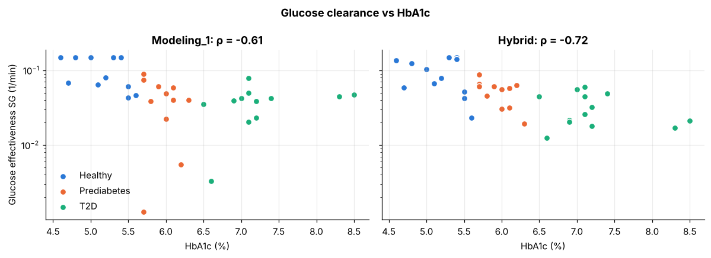
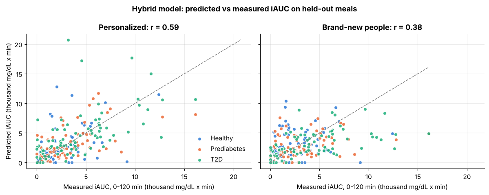

# Physics-informed modeling of post-meal glucose (CGMacros)

Predicting how blood glucose responds to a meal, using a small physiological model, a classic physics-informed neural network (PINN), and a hybrid model where a neural network adjusts the physics meal by meal. Built on the public [CGMacros](https://physionet.org/content/cgmacros/1.0.0/) dataset: 45 adults (healthy, prediabetes, type 2 diabetes), about 10 days each, with two continuous glucose monitors, a fitness tracker and detailed meal logs.

## Articles

A plain-language write-up of the project, in three parts on Medium:

1. [Two Glucose Sensors, One Person, 33 mg/dL Apart](https://medium.com/@adityashah841/two-glucose-sensors-one-person-33-mg-dl-apart-ef7995aaa6e5): what the data shows before any modeling (`EDA.ipynb`)
2. [A Good Fit Isn't the Same as the Right Answer](https://medium.com/@adityashah841/a-good-fit-isnt-the-same-as-the-right-answer-e056e7f8623f): the physics model and what its parameters reveal (`Modeling_1.ipynb`)
3. [Physics Sets the Shape, the Network Fills the Gaps](https://medium.com/@adityashah841/physics-sets-the-shape-the-network-fills-the-gaps-d11ee689bedf): the classic PINN and the hybrid physics–neural model (`PINN_modeling.ipynb`)

## Results at a glance

Held-out meals (each person's last 30% of meals), 36 participants, 234 test meals. Median per-meal error over the 3-hour post-meal curve:

| Model | RMSE (mg/dL) | Peak height error | T2D RMSE |
|---|---|---|---|
| Baseline: person's average rise per gram of carbs | 23.3 | 20.6 | 30.4 |
| Physics model (4 ODEs, 3 parameters per person) | 23.9 | 23.1 | 30.8 |
| **Hybrid physics–neural model** | **22.4** | **20.8** | **27.8** |

Hybrid minus physics model, with 95% confidence intervals from resampling participants:

| | Median difference in RMSE (mg/dL) | 95% CI |
|---|---|---|
| All test meals | −1.7 | −3.2 to −0.1 |
| Type 2 diabetes | −4.3 | −8.2 to −1.4 |

Other results:
- **New people, no calibration** (5-fold cross-validation by participant): 25.0 mg/dL for the hybrid vs 27.9 for the physics model.
- **Per-person glucose clearance tracks HbA1c:** Spearman ρ = −0.72 for the hybrid (−0.61 for the physics model), robust to removing participants with discordant diagnostic labels and women under 45.
- **Learned meal effects match physiology:** fat and fiber slow absorption (absorption peak moving from about 50 to over 120 minutes).
- **Ranking meals by their 2-hour glucose rise (iAUC),** the metric most published studies report: Pearson r = 0.59 on all test meals (95% CI 0.49 to 0.69, resampling participants), vs 0.48 for the baseline and 0.47 for the physics model. In the setting used by a recent study on the same dataset ([Kondratyeva et al.](https://arxiv.org/abs/2609.24453): new participants, lunches only), the hybrid reaches r = 0.57 (0.51 on the log scale), vs their 0.59 to 0.67 without microbiome data, using no clinical inputs. Setups differ, so this is a like-for-like setting, not an identical benchmark.

## Key findings

**Data (EDA)**
- The two glucose sensors disagree substantially: the Libre (arm) reads about 33 mg/dL lower than the Dexcom (abdomen) for almost every participant, with a raw disagreement (MARD) of about 24%. A per-person linear correction brings this to about 9%, so it's a calibration offset rather than noise. The Libre also leads the Dexcom by about 7 minutes. Dexcom is used as the target.

- Post-meal responses scale with metabolic status: median rise of about 39, 55 and 68 mg/dL, peaking at about 60, 70 and 90 minutes, for healthy, prediabetes and T2D. For an identical standardized breakfast, the median rise was about 47, 73 and 117 mg/dL.
- Carbohydrate amount alone explains little of the response (correlation about 0.17); who ate the meal explains about 20% of the variation.
- Several unrecorded factors can bias models: unlogged eating (most participants show at least one unexplained glucose rise per day), disagreement between HbA1c and fasting-glucose diagnoses (12 of 45 participants), missing wearable data, overnight sensor compression artifacts, medications and menstrual-cycle phase. Each is checked or discussed, with references, in `EDA.ipynb` section 10.

**Physics model**
- A two-compartment gut absorption model feeding a simplified Bergman minimal model, with insulin action driven by glucose (no insulin data available).
- On synthetic data, parameters are recovered within about 2–8%. On real data, insulin sensitivity is not identifiable from glucose curves alone; glucose effectiveness carries the clearance signal.
- Refitting on "clean" meals (glucose steady before eating) sharpens the link between clearance and HbA1c but does not improve T2D prediction.

**Classic PINN vs hybrid**
- The classic PINN fits a synthetic meal within about 1 mg/dL of the truth, but cannot separate the two clearance parameters from a single meal, and takes about 200× longer than solving the ODEs directly. On a real meal with an unlogged second rise, it fits the data by violating the physics, which shows up as a high physics residual.

- The hybrid keeps the ODEs as the backbone. A small network sets each meal's absorption speed, effective carbohydrates, and how far glucose settles toward the person's resting level. Model versions were chosen on a separate validation set before the single test evaluation.

## Notebooks

| Notebook | Contents |
|---|---|
| [`EDA.ipynb`](notebooks/EDA.ipynb) | Loading and cleaning, sensor agreement, glucose patterns, meal quality, post-meal responses, activity, unrecorded confounders |
| [`Modeling_1.ipynb`](notebooks/Modeling_1.ipynb) | Physics model: baselines, synthetic identifiability test, per-person fitting with empirical Bayes, clean-meal refit, calibration-free prediction, parameters vs HbA1c |
| [`PINN_modeling.ipynb`](notebooks/PINN_modeling.ipynb) | Part A: classic PINN. Part B: hybrid physics–neural model, ablation, test evaluation with bootstrap confidence intervals, learned meal effects, new-person cross-validation, iAUC comparison with published work |

## Reproducing

1. Download CGMacros (see [`data/README.md`](data/README.md)).
2. Copy the three notebooks into the extracted `CGMacros` folder (the one containing `bio.csv`).
3. Install requirements: `pip install -r requirements.txt`
4. Run the notebooks in order: `EDA.ipynb` → `Modeling_1.ipynb` → `PINN_modeling.ipynb`. Each one writes its outputs to a `processed/` folder used by the next.

All runs are CPU-only. The PINN notebook takes about 5–10 minutes on a laptop CPU and is seeded for reproducibility.

## Limitations

- 45 participants and about 10 days each; test sets are small, so differences under about 1 mg/dL are within noise.
- No insulin or medication data. T2D results reflect treated physiology.
- Meal macronutrients are logged estimates, and some eating was not logged.
- Glucose targets come from one CGM (Dexcom G6), which itself differs from the second sensor.
- Peak timing is not improved by any model, and the hybrid slightly over-predicts (median bias about +5 mg/dL).
- Results are from a single dataset and have not been validated externally.

## Data and license

The code in this repository is released under the [MIT License](LICENSE).

The CGMacros data is **not** included. It is available from PhysioNet under the Creative Commons Attribution-NonCommercial-ShareAlike 4.0 license; see [`data/README.md`](data/README.md). Cite the dataset as requested on its [PhysioNet page](https://physionet.org/content/cgmacros/1.0.0/), along with the standard PhysioNet reference:

> Goldberger AL, Amaral LAN, Glass L, et al. PhysioBank, PhysioToolkit, and PhysioNet: components of a new research resource for complex physiologic signals. *Circulation*. 2000;101(23):e215–e220.

## Disclaimer

This is a research and learning project. It is not a medical device and does not provide medical advice.
